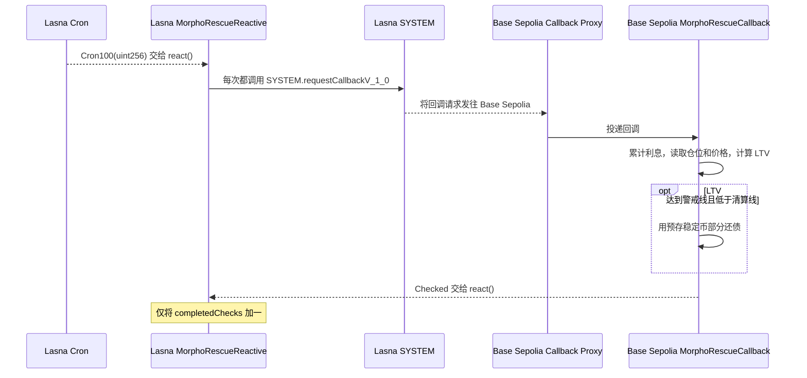

# 测试网 Morpho Blue 仓位自救用例拆解卡

这个黑客松项目为一个 Morpho Blue 市场中的一个借款人仓位设计自救机制。只有 Cron100 能发起检查，唯一的救援动作是部分还债。本机 `forge test` 已通过 17/17 项测试，项目尚未部署到任何测试网。营内已经上链的“三步走”是另一项模板练习，其中的 `Ping` 和 `Handled` 发生在 Ethereum Sepolia。

## 监听哪条链、哪个合约的什么事件？

按设计，`MorphoRescueReactive` 部署在 Lasna（chainId 5318007），在构造函数中通过 Omni 的 `SYSTEM.subscribe` 建立两项订阅。

- **定时检查。** Lasna 的 Cron 事件发射地址是 `0x0000000000000000000000000000000000fffFfF`。它约每 100 个区块发出一次 `Cron100(uint256)`，间隔约 2 分钟。负责接收订阅的 SYSTEM 是另一个合约，地址为 `0x8888888888888888888888888888888888888888`。
- **完成计数。** Base Sepolia（chainId 84532）上的 `MorphoRescueCallback` 发出 `Checked`，表示一次检查已完成。Lasna 的 `react()` 收到它时，只把 `completedChecks` 加一，本次处理到此结束。

## 满足什么条件时触发？

每收到一次 Lasna 的 `Cron100`，`MorphoRescueReactive.react()` 都会调用 `SYSTEM.requestCallbackV_1_0`。Lasna 读不到 Base Sepolia 的 Morpho 仓位或价格，因此请求回调之前没有 LTV 筛选。两次 Cron 之间即使价格变化，也要等下一次定时检查。

还债条件只在 Base Sepolia 的回调里判断。LTV 是债务价值占抵押品价值的比例，LLTV 是市场的清算阈值，两者都用 WAD（1e18）表示。假设 LLTV = 0.8，警戒 LTV 就取 LLTV × 90% = 0.72，目标 LTV 取 0.6。只有 `warning <= LTV < LLTV` 时才会动用救援金。低于警戒线时无需还债。达到或越过清算线（`LTV >= LLTV`）时，合约只记录跳过。

## 在哪条链做什么动作？

Base Sepolia 的 Callback Proxy 将请求投递给 `MorphoRescueCallback`。回调合约先调用 `accrueInterest` 累计利息，再读取市场数据、借款人的仓位和预言机（oracle）价格，用更新后的债务和抵押品价值计算 LTV。

如果仓位落在救援区间，回调合约会算出回到目标 LTV 需要偿还的债务，只向固定的 Morpho 合约授权（`approve`）使用本次所需的预存稳定币，然后调用 `repay` 为该仓位部分还债，并清除剩余额度。救援金不足时最多只能用掉现有余额，无法完整救援。回调合约不从借款人钱包扣款，也没有提款入口。无论本次检查是还债还是跳过，只要顺利结束，都会发出 `Checked`。下一次回调仍由下一次 Cron 触发。

## 如果不用 Reactive，你要怎么做（自己跑机器人？手动？）——Reactive 让它简单在哪里，代价是什么？

我可以自己运行轮询机器人，定期查询仓位并在需要时发送还债交易。这需要一台常驻服务器，还得保管机器人的热钱包。另一种做法是自己盯盘，接近警戒线时手动还债。采用 Reactive 后，定时触发和还债规则都在链上执行，省去了服务器运维，也不必让机器人持有热钱包密钥。

这套测试网骨架的代价是每次 Cron 触发都要付费，即使仓位安全、没有还债也一样。Lasna 合约一旦欠费（`debt > 0`）就会静默停止接收事件，Base Sepolia 的回调也要备好 ETH 支付费用。约 2 分钟的检查间隔还意味着，价格如果快速跌破清算线，下一轮检查可能已经来不及。这些限制决定了当前演示只能验证定时自救流程，离完整的借贷产品还有距离。
